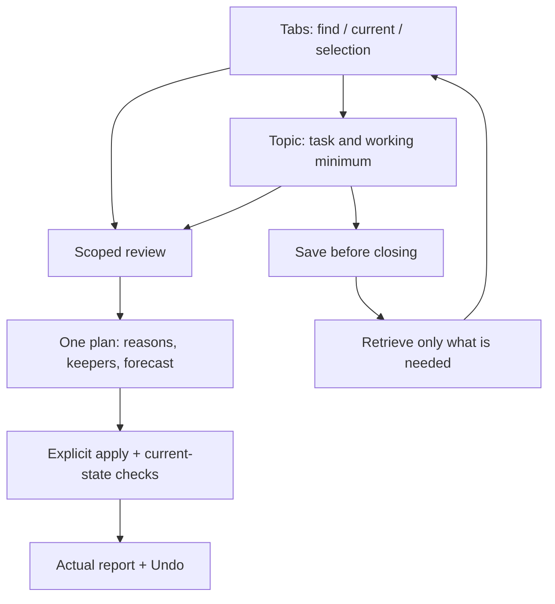

# AITab — product and implementation reference

Current workspace: 2026-10-19. Start with [README](README.md), [SETUP](SETUP.md)
and [architecture](docs/ARCHITECTURE.md). Source types/routes linked below are
canonical; this document describes contracts instead of duplicating interfaces.

## Product contract

Reduce open-tab load while retaining access to useful sources. Distinguish exact
copies, semantic overlap, complementary sources, topical obsolescence and useful
material that can be deferred. Topic similarity is not redundancy. Visit age is
not evidence of obsolescence. AI proposes; explicit validated actions execute.
URL/layout recovery cannot restore arbitrary unsent state.

## Workspace

| Destination | Purpose |
|---|---|
| Tabs (default) | Current work, window scope, search, selection, Inbox and contextual Review |
| Topics | Permanent task catalog, working minimum, common/unique comparison, merge/link/split |
| Library | Saved materials and task collections, notes, open/focus one page, optional comparison |
| More → Review tabs | Resume one scoped plan; category filters retain selection |
| More → Journal and Undo | Actual browser outcomes and separate structural topic history |
| More → Reports / Activity | Analytics, habits, activity and refreshable insights |
| More → Snapshots / Recovery / Settings | Session snapshots, backups, providers and diagnostics |
| Search → By meaning / ask a question | Separately labelled server-history/analysis search |

Shared local search covers titles, URLs, notes, reasons, task focus and topic names.
Scopes are Open/Saved/Everything. Filters: `domain:`, `collection:`, `topic:`,
`window:` and `status:`. Hidden selections remain visible in a counter. Review
captures IDs and exact URLs at entry; navigation retains its plan and background jobs.

## Entities and ownership

| Entity | Identity / owner | Meaning |
|---|---|---|
| Live tab | Chrome session, ID and current URL | Stateful page; ID alone is not durable close proof |
| Topic | Local stable UUID, source/manual revisions | Task name, focus, materials, aliases, exclusions and relations |
| Collection | Local UUID/revision, saved-item UUIDs | Detached links, notes, purpose, reason, focus and review reminder |
| Chrome group | Window/group IDs | Layout; collapse does not reduce tab count |
| Persistent cluster | SQLite | AI source adapted into the catalog, not a second user-facing entity |
| Review job / plan | Session ID, scope, expiry | Temporary analysis and reviewed proposals |
| Browser operation | Durable UUID/per-item states | Write-before-effect journal and idempotent Undo |
| Topic change | Structural snapshots and revision guards | Reversible organization without browser effects |

Topics adapt collections, groups, recent AI topics and cached server clusters.
Manual names/focus/exclusions survive refresh. AI lineage preserves manual merge
and split decisions. Merge retains aliases, unique material and source references;
different tasks can stay linked. Notes remain in source collections. Import remaps
saved-chat identity as well as topic/collection IDs. See [TOPICS](docs/TOPICS.md).

## Review invariants

- One plan serves exact/tracking copies, redundancy, outdated content, already-saved
  material and explicit useful deferral. Each live tab counts once.
- Exact unprotected copies can start selected. Default AI redundancy selection
  requires confidence ≥0.95 and excerpts for every member. Other categories require
  explicit selection; related sources remain available.
- Stateful chat roots/conversations are excluded from automatic optimization.
  Same URL can contain different drafts. Explicit manual close remains possible.
- Protected/important, pinned, active, audible and protected-domain pages are
  excluded from automatic closing. Keepers and dependent actions are checked.
- Action previews expire after five minutes. Explanations can stay visible, but
  execution requires a fresh plan and revalidates URL, group/window and revisions.
- Save-and-close persists collection and journal before effects. Storage failure
  prevents closing. Partial outcomes and unrelated count changes are reported.
- Undo restores confirmed successes once. Imported live IDs cannot target current
  tabs. Incognito is excluded. Structural topic Undo has no Chrome effects.

Details: [REVIEW](docs/REVIEW.md), [WORKSPACE](docs/WORKSPACE.md),
[RELIABILITY](docs/RELIABILITY.md).

## AI boundaries

| Operation | Supplied input | Result |
|---|---|---|
| Topic suggestions | Explicit batched tab analysis/cache | Suggestions and analysis history |
| Content/relevance | ≤600 normal non-chat HTTP(S) entries, optional ≤1,200-char excerpts | Session advice; no browser mutation |
| Library comparison | Balanced live/saved unique URLs within 600-entry cap | Read-only advice; saved IDs cannot close tabs |
| Deep page pair | Two selected URLs, accessible live text ≤8,000 chars each | Evidence; saved pages never open for extraction |
| Topic pair | Two topics, ≤60 sampled materials each, cached excerpts ≤1,200 chars | Relation and common/unique explanation with verified quotes |
| History question | SQLite retrieval and configured provider | Answer in a separately labelled scope |

Page metadata is JSON-quoted untrusted data. IDs and quotes are validated against
supplied sources; changed topic revisions invalidate pair advice. Missing text and
partial coverage are explicit. No external web verification or full-page equivalence
guarantee exists. The local server orchestrates CLIs that can send data to providers.
Codex defaults to `gpt-5.6-terra`, low reasoning; CLI-managed ChatGPT authentication
is described in SETUP. The task center shows stages, measured counts, elapsed time
and cancellation. AI wait is indeterminate: 90-second server budget, 100-second client.

## Canonical implementation contracts

| Layer | Files |
|---|---|
| Navigation / selection / scope | [store.ts](extension/src/side-panel/store.ts), [tab-filter.ts](extension/src/side-panel/tab-filter.ts) |
| Shared search | [library-index.ts](extension/src/side-panel/library-index.ts), [library.ts](extension/src/shared/utils/library.ts) |
| Catalog | [topics.ts](extension/src/shared/types/topics.ts), [topic-catalog.ts](extension/src/background/topic-catalog.ts) |
| Pair advice | [topic-pairs.ts](extension/src/shared/utils/topic-pairs.ts), [topic-advice.ts](extension/src/background/topic-advice.ts), [topic_review.py](server_core/topic_review.py) |
| Review / plan | [content-review.ts](extension/src/background/content-review.ts), [review-jobs.ts](extension/src/background/review-jobs.ts), [optimization.ts](extension/src/background/optimization.ts) |
| Journal / layout | [workspace-operations.ts](extension/src/background/workspace-operations.ts), [window-operations.ts](extension/src/background/window-operations.ts) |
| Protocol | [messages.ts](extension/src/shared/types/messages.ts), [service-worker.ts](extension/src/background/service-worker.ts) |
| Backups | [workspace-backup.ts](extension/src/background/workspace-backup.ts), [workspace_backups.py](server_core/workspace_backups.py) |
| HTTP / SQL | [agent.py](agent.py), [server_core](server_core) |

`POST /workspace-review` and `POST /topic-review` share the configured provider chain.
`GET/POST /workspace-backups` and `GET /workspace-backups/{id}` operate on bounded,
server-owned bundles; API restore never overwrites live SQLite. Existing analysis,
history, cluster and snapshot routes stay compatible. Origin/token guards apply.

## Persistence and deployment

`aitab.workspace.v1` owns collections, operations, remembered decisions, URL rules
and optional topic catalog/history. Session storage owns jobs, previews and browser
session identity. Evidence is derived cache excluded from backups. SQLite owns
analysis/cache/history/server clusters/snapshots. Legacy database and Obsidian
`TabOptimizer/*` paths stay compatible.

Portable JSON validates and appends with remapped IDs. Full backups add a consistent
SQLite copy with provider settings purged and SHA-256 manifests. JSON/SQL snapshots
are separate moments. Schedules are opt-in; SQL replacement requires a stopped server.

Build `extension/dist/` and Reload the existing installation. Preserve its old loader
path/ID during [migration](docs/MIGRATION.md); removing the extension can separate
profile-local data. `pnpm server` starts loopback FastAPI.

## Validation and next work

[TESTING](docs/TESTING.md) gives commands; [TEST_REPORT](docs/testing/TEST_REPORT.md)
records evidence and limits. Automated suites use isolated profiles/databases and
synthetic provider responses. Large-workspace measurements are reproducible local
observations, not a human study or corpus-wide semantic accuracy claim.

The [UX plan](docs/plans/usability-tabs-topics.md) follows the earlier
[product review](docs/plans/product-development.md). External relevance verification,
full incremental semantic recomputation, topic trees, drag/drop and cross-device
sync remain future work.
