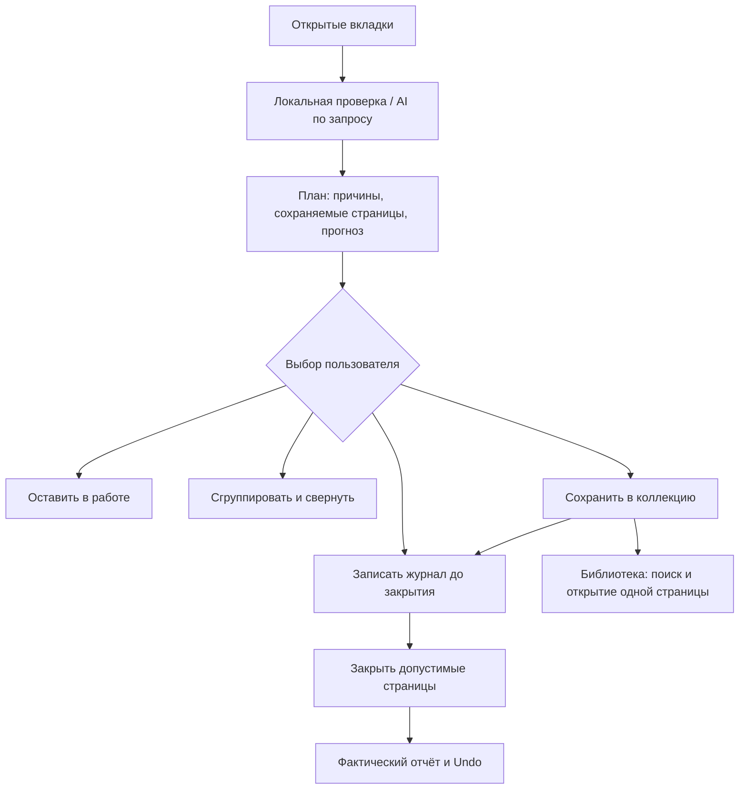
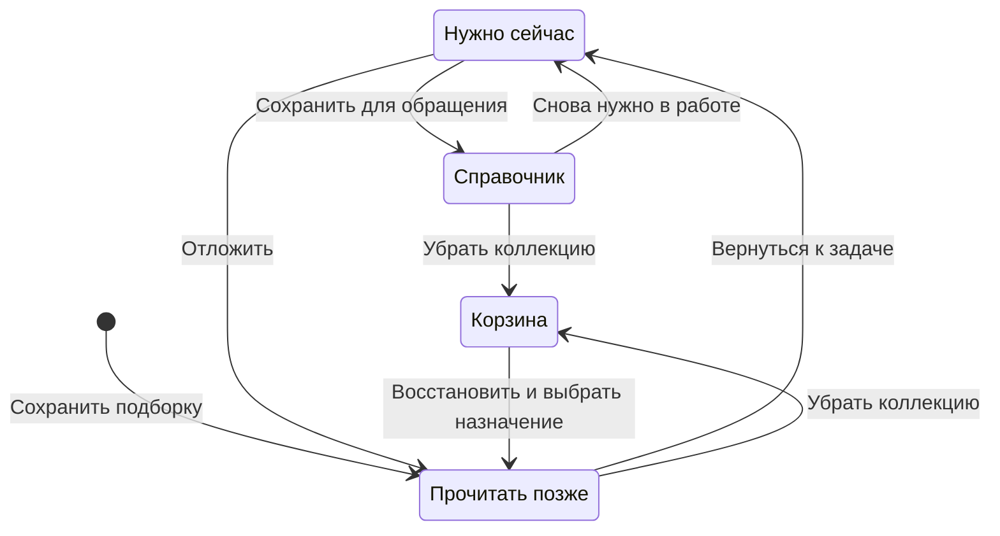
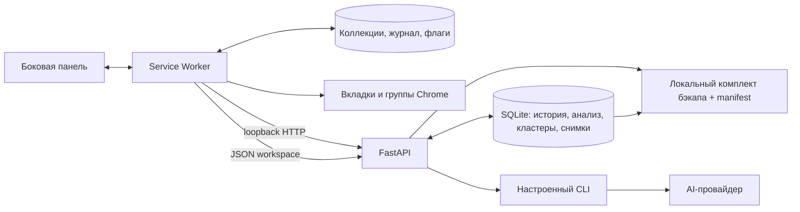

# AITab

**Меньше открытых вкладок, актуальные материалы и доступная библиотека без повторов.**

[](https://github.com/eiler2005/ai-tab-optimizer/actions/workflows/ci.yml)
[](CHANGELOG.md)
[](extension/public/manifest.json)
[](LICENSE)

AITab помогает разобрать сотни вкладок: найти точные копии, сравнить пересечение
содержания, проверить актуальность относительно задачи и убрать полезные материалы
в коллекции. Сначала расширение показывает предложение и расчёт, затем пользователь
отдельно применяет действие. Успешные закрытия можно отменить через историю.

Расширение работает локально с Chrome. Сервер FastAPI нужен для AI, истории и
аналитики SQLite, сохранённых кластеров и полного резервного копирования.
Базовая очистка и коллекции доступны без сервера. Настроенный AI-провайдер получает
данные только при запуске соответствующего анализа; локальный сервер не означает
локальное выполнение самой модели. Телеметрии и обязательной облачной учётной записи нет.

## Установка и обновление

Нужны Node.js/pnpm, Python 3.11+ и Chrome с поддержкой Side Panel.

```bash
git clone https://github.com/eiler2005/ai-tab-optimizer.git aitab
cd aitab
cd extension
pnpm install --frozen-lockfile
pnpm build
cd ..
python3 -m venv .venv
.venv/bin/pip install -r requirements.txt
pnpm server
```

Откройте `chrome://extensions`, включите режим разработчика и загрузите
**`extension/dist/`** как распакованное расширение. Сервер слушает
`http://127.0.0.1:8765`. Нажатие на значок открывает боковую панель.

Если расширение уже установлено, обновите исходники, выполните сборку и нажмите
**Reload / Обновить** у существующей установки. При локальном переименовании
`firstai_agentproj → aitab` используйте прежнюю установку и совместимую папку
загрузки: смена пути может изменить ID расширения и отделить старые данные.
Подробности: [SETUP.md](SETUP.md), [миграция](docs/MIGRATION.md).

В Settings выберите CLI-провайдер и проверьте соединение. Codex CLI может использовать
существующий вход через ChatGPT; настройка описана в SETUP. Текущая модель Codex по
умолчанию — `gpt-5.6-terra` с низкой глубиной рассуждений. Ключи и авторизацию
хранят инструменты провайдера.

## С чего начать

Основная навигация: **Вкладки · Темы · Библиотека · Ещё**. Расширение открывается
со списка вкладок. В меню «Ещё» доступны разбор, журнал с Undo, активность, отчёты,
снимки, резервные копии и настройки. Вкладки можно найти и сохранить без AI.

Общий разбор из вкладок, выбранных строк и темы использует один план с прогнозом,
доказательствами, отдельным применением и отчётом. Подробнее: [разбор и Undo](docs/REVIEW.md).

Перестройка интерфейса выполняется по [UX-плану](docs/plans/usability-tabs-topics.md);
состояние каждого этапа отмечено в нём.

1. **Ещё → Разбор вкладок → Optimize.** Подготовьте план, при необходимости включив AI.
   Посмотрите прогноз, оставляемые страницы и причины. Кнопка **Apply plan (N)**
   применяет только выбранные предложения; прогресс и отмена доступны отдельно.
2. **Библиотека → Коллекции.** Сохраните тему как «Нужно сейчас», «Прочитать позже»
   или «Справочник». Добавьте задачу и причину сохранения. **Save and close**
   сначала записывает коллекцию, затем закрывает допустимые страницы.
3. **Библиотека → Материалы.** Найдите сохранённый материал по заголовку, URL, заметке
   или задаче. Откройте одну страницу либо переключитесь на её открытую копию.
4. **Темы.** Отметьте рабочий минимум, который
   останется открытым. Остальное можно сохранить и закрыть после просмотра.
   **Group and collapse** только сворачивает группы браузера и не уменьшает число вкладок.
5. **Ещё → Журнал и Undo.** Проверьте фактические результаты и выполните Undo.
   Для переноса данных скачайте JSON; для комплекта со SQLite настройте полные бэкапы.



## Кластеры, группы и коллекции

В рабочем интерфейсе используется единое название **«Темы»**. Постоянный каталог
объединяет источники из коллекций, групп Chrome и AI, сохраняя ручные названия,
задачи и исключения состава. Подробнее: [работа с темами](docs/TOPICS.md).

| Понятие | Назначение | Где хранится | Сокращает открытые вкладки |
|---|---|---|---|
| Тематический кластер | Связывает материалы по задаче или теме; разные источники могут дополнять друг друга | AI-результат; постоянные кластеры — SQLite | Через отдельное действие сохранения и закрытия |
| Группа браузера | Организует живые вкладки в окне Chrome | Chrome | Сворачивание меняет только отображение |
| Коллекция | Хранит ссылки, заметки, назначение и контекст задачи независимо от открытых вкладок | Локальные данные расширения | Да, через Save and close |
| Снимок | Сохраняет набор URL и расположение окон/групп для восстановления | SQLite или локальный буфер | Сам по себе ничего не закрывает |

Коллекции можно переименовывать, объединять в новый набор без точных URL-повторов
и перемещать в обратимую корзину. Исходники объединения сохраняются, заметки
объединяются. Полезная подборка может перейти из текущей работы в справочник;
это не означает, что её содержание устарело.



## Что умеет каждый раздел

| Раздел | Как использовать |
|---|---|
| Optimize | Общий прогноз сокращения, выбор кандидатов, применение, отчёт Markdown и Undo |
| Duplicates | Категория общего плана; радиокнопка выбирает оставляемую копию, строки выбираются для явного применения |
| Similar content | Категория общего плана; пересечение, различия, доказательства и дополняющие источники |
| Outdated content | Истёкшие события/сроки, заменённые инструкции и материалы вне явно указанной задачи |
| Collections | Сохранение, назначение, заметки, объединение, корзина, JSON и полные бэкапы |
| Library | Общий поиск открытого и сохранённого; сравнение библиотеки и углубление выбранной пары |
| Темы | Темы из коллекций, групп Chrome, AI и постоянных кластеров; рабочий минимум и сохранение остатка |
| Windows | Перенос выбранных живых вкладок и групп между окнами с Undo |
| Tabs | Обзор, фильтры, флаги и массовые действия; подсказка об уже открытом/сохранённом материале |
| Ещё → Отчёты | Аналитика, статистика активности и история рекомендаций; действия доступны в Темах и общем разборе |
| Общий поиск → По смыслу / задать вопрос | Диалоговый поиск по SQLite: история, результаты анализа и постоянные кластеры |
| Ещё → Снимки / Настройки | Восстановление наборов, провайдеры, диагностика и экспорт в Obsidian |

### Поиск и предотвращение повторов

Общая строка поиска во Вкладках, Темах и Библиотеке ищет по заголовкам, URL,
заметкам, причинам сохранения и задачам. Область «Открытые / Сохранённые / Всё»
показывается явно. Ищите по теме через `topic:`, по окну через `window:`.
«По смыслу / задать вопрос» открывает отдельный поиск по истории и результатам
анализа; локальные фильтры не ограничивают его область.
Пример: `migration status:reference collection:"React notes"`.
Фильтры: `collection:`, `domain:`, `topic:`, `window:`, `status:open|now|later|reference`.
Корзина исключена; у результата видны сохранённые местоположения и открытые копии.

В Library настраиваются правила по точному домену: предложить коллекцию либо
автоматически сохранить ссылку. Первое подходящее правило побеждает. Повторная
загрузка не создаёт новую запись; правила не закрывают страницы.
Контекстное меню **AITab: save page to Inbox** сохраняет обычную страницу во
«Входящие». Горячую клавишу можно назначить в `chrome://extensions/shortcuts`.

### Содержание и актуальность

Общая тема не делает источники дублями. В сравнении показываются пересечение,
уникальная ценность и доступные доказательства с датой чтения. В Library можно
сравнить открытое с сохранённым; для закрытых страниц используются заголовки
и доступные сохранённые фрагменты, без автоматического открытия ссылок.

Обычная проверка использует до 1 200 символов на страницу. Углублённое сравнение
двух выбранных URL читает до 8 000 символов доступного основного текста и дат.
AI охватывает до 600 страниц за проверку; локальные и сохранённые источники
чередуются, одинаковые URL не расходуют места повторно в проверке библиотеки.
Спящие вкладки не пробуждаются. Недостаток текста виден в результатах.

Фокус проверки сохраняется и может быть взят из коллекции. Решения «это всё ещё
нужно» и «источники дополняют друг друга» учитываются до 30 дней при тех же
доступных доказательствах и задаче. Дата пересмотра напоминает проверить подборку.
**Давность посещения не доказывает неактуальность.** Проверка по вашим страницам
не является поиском самой свежей информации в интернете.

### Безопасность действий и отчёт

Точные копии и подтверждённые AI как избыточные материалы с достаточными выдержками
могут входить в первоначальный выбор плана. Дополнительно можно вручную выбрать сохранение
полезных страниц в новую коллекцию «Позже» перед закрытием. Tracking-варианты, неактуальность и
страницы, уже сохранённые в коллекциях, требуют ручного выбора. Обязателен отдельный
клик применения. Процент уверенности модели не гарантирует отсутствие потерь.

Закреплённые, активные, звучащие, важные и защищённые вкладки исключены из
автоматической очистки. Поддерживаемые чаты, включая ChatGPT, обрабатываются
отдельно: одинаковый URL может содержать разные черновики или состояние.

План проверяет актуальные URL, защиту, сохраняемые копии и ревизии коллекций.
Журнал записывается до закрытия. Отчёт различает прогноз и факт, повторы,
сохранённые материалы, неактуальные страницы, пропуски и ошибки.
Undo восстанавливает успешные закрытия один раз. **URL и расположение можно
восстановить; несохранённый текст и произвольное состояние приложения — не всегда.**

## Данные, резервные копии и AI



- **JSON-бэкап расширения** переносит коллекции, заметки, историю операций,
  безопасные настройки, фокус и решения проверки. Импорт сначала показывает
  состав, затем добавляет данные, сохраняя существующие. Вкладки не открываются.
- **Полный локальный бэкап** добавляет согласованный снимок SQLite. В Collections
  откройте **Automatic backups and restore**: создайте копию сейчас или включите
  расписание 1–168 часов, с хранением 1–30 версий. По умолчанию расписание выключено.
- Комплект содержит `workspace.json`, `database.sqlite` и `manifest.json`
  с SHA-256. По умолчанию папка —
  `~/.local/share/aitab/backups/workspace/`; серверная переменная
  `AITAB_BACKUP_DIR` меняет её. Проверка контрольных сумм предшествует импорту.
- Настройки провайдеров и их авторизация, производный кэш текста, разрешения
  на папку Obsidian и черновики страниц не переносятся. Полная копия SQLite
  очищается от настроек провайдеров.
- Облачная синхронизация не требуется. Папка копий находится на том же компьютере;
  для защиты от потери диска сохраните её также на другом носителе.
- AI по явному запросу получает заголовки, URL, задачу и включённые фрагменты.
  Контент страниц считается недоверенными данными; модель не выполняет
  браузерные действия.

Пошаговое восстановление и границы атомарности:
[WORKSPACE.md](docs/WORKSPACE.md). Описание доступа:
[SECURITY.md](SECURITY.md). Экспорт в Obsidian:
[OBSIDIAN_INTEGRATION.md](OBSIDIAN_INTEGRATION.md).

## Разработка и проверки

```bash
cd extension
pnpm typecheck
pnpm test
pnpm build
pnpm test:e2e
cd ..
.venv/bin/pytest -q
.venv/bin/python -m py_compile agent.py server_core/*.py
```

E2E использует отдельные временные профили Chromium и синтетические страницы.
Сквозной тест запускает настоящий FastAPI с временной SQLite и проверяет полный
бэкап и импорт; пользовательские вкладки, база и AI-аккаунт не используются.
CI выполняет проверки TypeScript, сборку, Vitest, pytest и Chromium E2E.

| Документ | Содержание |
|---|---|
| [SETUP.md](SETUP.md) | Окружение, CLI-провайдеры, запуск и диагностика |
| [docs/WORKSPACE.md](docs/WORKSPACE.md) | Подробные сценарии и ограничения текущей реализации |
| [docs/ARCHITECTURE.md](docs/ARCHITECTURE.md) | Компоненты, потоки данных и решения |
| [PROJECT.md](PROJECT.md) | Внутренняя спецификация и протокол |
| [docs/testing/TEST_REPORT.md](docs/testing/TEST_REPORT.md) | Результаты проверок и их границы |
| [docs/plans/product-development.md](docs/plans/product-development.md) | Ревью TabMerger, выполненные направления и дальнейшее развитие |
| [docs/plans/usability-tabs-topics.md](docs/plans/usability-tabs-topics.md) | Реализация UX: вкладки первыми, единые темы, поиск и один сценарий разбора |
| [docs/IMPROVEMENTS.md](docs/IMPROVEMENTS.md) | Инженерный backlog |
| [CHANGELOG.md](CHANGELOG.md) | История изменений |
| [CONTRIBUTING.md](CONTRIBUTING.md) | Правила разработки |

## Лицензия

MIT — [LICENSE](LICENSE). Идеи организации материалов реализованы самостоятельно;
исходники, тексты и оформление TabMerger в продукт не переносились.
