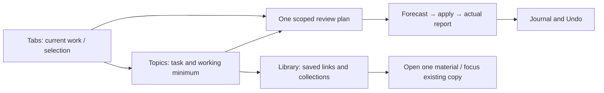

# Workspace: tabs, topics and saved materials

The main navigation is **Tabs · Topics · Library · More**. Tabs opens first;
cleanup is a contextual action rather than the starting screen. More contains
Review tabs, Journal and Undo, Reports, Activity, Snapshots, Recovery and backups,
and Settings. No AI connection is required for local search and organization.



Tabs uses the current-window/all-windows scope, shared search and optional topic
filter. Select results respects those filters; hidden selections have an explicit
counter and Show selected control. The current-page card saves to Inbox or reveals
the active page, clearing obstructing filters and rendering it beyond the initial
100 rows. Row actions are always reachable by keyboard through the ⋯ button.

Shared search has **Open / Saved / Everything** scopes and filters `domain:`,
`collection:`, `topic:`, `window:` and `status:open|now|later|reference`. The same
query follows navigation; each destination starts with its appropriate scope.
By meaning / ask a question opens a separately labelled server-history search;
local filters do not constrain that backend search.

Topics is the user-facing name for task-based groups. Its persistent catalog
adapts collections, Chrome groups, recent AI results and cached server clusters.
Manual names, focus and exclusions survive source refreshes. Compare common and
unique materials before merging, linking or splitting; these changes never close
tabs and have their own Undo. See [TOPICS.md](TOPICS.md).


## Library and task collections

Library → Collections supports Working now (`now`), Read later (`later`) and Reference
(`reference`). Add an optional reason, current task/relevance criteria and review date;
save these details when creating a collection or edit them on its card. Dates only mark
the collection due for review and never imply obsolescence or trigger deletion. Missing
metadata in older collections is read as Reference; no destructive migration occurs.

Library → Materials → Additional tools searches all normal open HTTP(S) pages and non-trashed collections,
including page notes, collection reasons and tasks. Combine words with `collection:`,
`domain:` and `status:open|now|later|reference`; quoted collection names are supported.
Matching exact addresses share a result with all saved locations and live-copy count.
Chat addresses retain separate results because their page state can differ.
Results are paged in batches of 50. Open page validates the saved collection/item IDs
again and opens only that item; an existing non-chat exact URL is focused instead.
Collection metadata is validated and preserved in portable backups.

## Library comparison and evidence

Library → Materials → Additional tools → **AI: compare library** includes non-trashed saved pages alongside
the chosen open-window scope. **Compare locally** needs no server. The same background
job/progress/cancellation mechanism applies. Live and saved entries have distinct review
IDs; saved IDs never address browser tabs. Results identify their source collection,
show overlap/unique-value explanations and expose available text with capture times.
This review is read-only: saved records are never deleted and its synthetic IDs cannot
be passed to the content-close operation. Exact live/saved URL matches are visible in
the library's locations and live-copy counts, independently of semantic matches.

Select two page URLs in the library and choose **Deep review selected pair** for up to
8,000 characters of accessible main/article text and supplied publication/modification
dates per live page. It does not fetch closed pages or wake discarded tabs. Standard
reviews retain their 1,200-character evidence bound; AI still covers at most 600 entries.
Accessible evidence is cached locally by exact URL/title for up to 24 hours, within a
900 KB cache budget. Saved pages can use that labelled historical evidence. Unchanged
live pages reuse cached excerpts; navigation, reload and title changes invalidate them.
Deep comparison always attempts a fresh read. Missing access is shown explicitly.
Disabling excerpts also disables cached text in provider requests. Evidence is derived
cache data, excluded from portable backups. It is not proof of full-page equivalence.

## Unified optimization

Choose **Review…** from Tabs, selected rows or a topic, or **More → Review tabs**. The current IDs and exact URLs define the scope. Click **Optimize tabs — prepare plan** to see a
before/after forecast, proposed closures, the page retained for each candidate,
and counts for protected pages, preserved chats and alternative material. Exact
URL copies form the initial local plan. A fresh matching content review is reused;
otherwise the optional AI checkbox starts a review and refines the local plan
when it completes. Preparing a plan never closes pages. **Apply plan (N)** is a
separate action in a persistent footer that stays visible while the list scrolls.

Default selection includes unprotected exact copies and AI-labelled redundant
content with confidence at least 0.95 and excerpts available for every member.
Related/alternative material is retained. Tracking variants, lower-confidence
redundancy and topical obsolescence require explicit manual selection. Chats are
excluded. A retained page cannot be selected while another selected candidate
depends on it. The plan expires after five minutes; execution rechecks URLs,
window/group membership and current protections, journals before each close, and
supports idempotent Undo. Content equivalence is an informed suggestion rather
than a guarantee about every part of a page or unsaved application state.

After applying, the report distinguishes the forecast from **actual** before/after
counts, successful closes, skips and failures. **Download report** exports the
chosen pages, reasons, retained URLs and available outcomes as Markdown. The
numeric outcome summary also persists in operation history. **Undo optimization**
restores successful closes once. The report describes the original close operation;
its counters are historical after Undo. Temporary plans and live review jobs are
session state, not portable backups.

## Review progress and available controls

Review focus persists locally between panel sessions. Review options can load the
current task saved on a collection. A collection's review date is a local reminder
on its card, not a claim about the age or quality of its pages.

**Still useful — remember** and **Retain: complementary sources** store up to 500
decisions for 30 days. A SHA-256 key covers exact URLs, titles, available evidence and
focus; changed evidence/focus or expiration triggers a new review. A title-only
decision cannot establish equivalence of unseen text. Decisions and focus survive
portable backup/import; no live browser IDs are imported for them. These decisions
suppress repeated suggestions on the next review and never initiate browser actions.

Content review runs as a background job, independent of the short action lock.
The persistent progress card shows capture, excerpt reading, local comparison,
AI waiting and completion. Excerpt counts are measured and the optional remaining
time is estimated from observed extraction speed. AI waiting is indeterminate,
with elapsed time and a 100-second client wait limit rather than an invented
percentage. Provider attempts share a 90-second server budget. Cancel stops
further extraction/submission and aborts an in-flight local request; the server
cancels the provider coroutine on disconnect and terminates its owned Codex process.

Progress/results survive closing and reopening the panel in the same worker
session. A worker restart marks an unfinished job interrupted and invites a new
review. Switching review categories while AI runs does not disable duplicate
selection or local actions. Apply buttons and selected counts stay in a separate
footer outside the scrolling list, including the zero-selection disabled state.
Each disabled row explains its protection or survivor dependency. To close the
currently retained copy, first choose another survivor with the radio button.

## Duplicate review

Open **Review…**, choose the scope and prepare the shared plan, then use its **Duplicates** filter. Exact groups compare full HTTP(S) URLs. Tracking variants only strip a small list of known analytics parameters; fragments, `ref`, `source`, path case and trailing slashes remain meaningful.

The radio button chooses the surviving copy; checkboxes choose copies to close. Protected/important, pinned, active, audible and protected-domain tabs are excluded from automatic closing. Tracking variants start unselected. A preview expires after five minutes; execution rechecks each URL, window/group, survivor and current protection. Changed or missing targets are skipped. Selecting a survivor for deletion is rejected.

ChatGPT and other supported chat applications are stateful: matching root or
conversation URLs do not prove identical drafts or page state. Address matches
appear separately as **Chats sharing an address — manual review**, with no
preselection. Different conversation IDs are kept separate. AI content review,
automatic close actions and rule-engine duplicate badges exclude these chat pages.
Explicit per-copy manual review can close an unprotected chat copy; Undo restores
the URL/layout, not unsent drafts. Related material from different authors is
classified separately from redundant information; missing AI relation labels
default to related material.

Offline workspace mutations run in the service worker through a serialized queue. Exact duplicate cleanup, window moves, collections and Undo need no AI server or network request. Optional content review uses the configured AI server. Before each close, the operation and original tab metadata are persisted to `chrome.storage.local` under `aitab.workspace.v1` (version 1). Repeating a preview execution returns its existing operation, preventing repeated closes.

## Similar content and topical obsolescence

In the shared **Review tabs** plan, enter a current focus and optionally enable AI.
For example: "I am moving to React 19; registration for the 2025 conference is
no longer relevant." Similar content and Outdated content filter that same plan.
Selection is preserved across categories and its hidden-category count is shown.
Apply plan is a separate action; the journal reports actual outcomes and Undo.
Tracking variants, outdated content and useful pages deferred to a collection
require explicit choice. A useful deferred page is saved before closing and is
not labelled obsolete. See [REVIEW.md](REVIEW.md) for all categories and limits.

Content overlap can span different URLs and domains. Sharing a broad topic is
insufficient: the prompt asks for overlapping information and differences that
might make both pages useful. Topical obsolescence uses expired events/deadlines,
material superseded by an open replacement, and the explicit current focus.
**Time since last visit is never sent or used for this classification.** Old
publication dates or version numbers alone do not establish obsolescence.
Every obsolete-content suggestion needs an explanation, confidence of at least
0.8, and a short quote verified against that page's supplied title/URL/excerpt.
Replacement IDs must refer to supplied pages; a replacement cannot itself appear
in the obsolete list. These checks establish grounding, not factual certainty:
review the reasons before closing.

The optional excerpt checkbox requests HTTP(S) page permission on the scan click.
The extractor reads H1, description and up to 500 characters of page text,
combined and bounded to 1,200 characters per page. Extraction runs five pages at
a time, skips discarded pages without waking them, and drops excerpts if the
URL changes during capture. Inaccessible pages are explicitly counted and use
title/URL evidence only. Enabled excerpts, titles, URLs and focus are sent to the
configured AI provider. Full documents, login state and visit-age history are not
supplied. AI/extraction covers at most the first 600 normal non-private HTTP(S)
non-chat tabs in the chosen scope; the UI reports the total and AI coverage and suggests
choosing another window above that limit. Content can change at a stable URL,
so short excerpts do not guarantee full-page equivalence.

**Compare locally without AI** uses distinctive-title or substantial excerpt
word overlap and labels the evidence accordingly; at most 200 candidate pairs
are shown. It does not invent obsolete-content recommendations. If the AI server
fails, local matches remain available with an explicit warning. AI suggestions
are capped at 100 content groups. Review previews expire after five minutes.
Selected pages and surviving/replacement pages are revalidated before closing,
and existing protections, write-before-close journaling and idempotent Undo apply.

The local server uses `POST /workspace-review` and the same configured CLI chain
as analysis. A current Codex CLI signed in with ChatGPT can use the subscription;
GPT-5.6 Terra with low reasoning is the AITab default. See [SETUP.md](../SETUP.md).

## Window consolidation

In Tabs → Merge windows, choose a target and explicitly select source windows or individual tabs. Preview lists the exact pages and group labels. Execution moves existing live tabs instead of closing/reopening pages. Entire selected groups move as a unit through `chrome.tabGroups.move`; subsets are regrouped in the target with their original name, colour and collapsed state. Pinned tabs stay in the pinned section and the target's existing active tab is retained.

The same operation journal records each result. Changed URLs, windows, group membership or pinning invalidate individual preview targets. Errors are reported per tab; successful moves can be undone independently. Undo moves the original live tab IDs back, recreating a source window with its existing tab if Chrome automatically closed that now-empty window. It creates no duplicate pages or placeholder tabs. Undo restores source groups and active tabs. After a full browser restart, live-ID move undo is refused rather than applying old IDs to unrelated tabs; use a saved collection or snapshot for URL restoration.

## Saved collections

Library → Collections saves all normal windows, one window, or tabs selected in the tab list. Preview names the exact URLs. Save and close persists the collection and recovery journal together before closing any unprotected tab. Changed/failed/protected tabs remain open and their outcomes are reported. Useful deferral in the shared review creates a collection before closing the page.

Saved pages have independent UUIDs, notes, timestamps, page flags and logical group keys; they never address live Chrome tab IDs. Opening a collection only opens missing URLs and restores layout/group metadata. Same-URL page flags are reapplied to newly opened pages without replacing current flags.

Select one collection to create a deduplicated copy, or several collections to combine them. Preview reports before/after counts and resulting URLs. Only full URL matches are merged. Different notes are combined, stronger flags and pinning are retained, and all source collections remain unchanged. Source revisions are checked again on confirmation. Collections can be renamed, edited and moved to reversible trash. Permanent deletion requires a separate confirmation from trash.

## Preventing repeated accumulation

Tabs shows a local hint for the focused normal-window page if an exact non-chat copy
is already open/saved, or its hostname matches a collection rule. The hint can focus
an existing copy or save to the suggested collection. It never closes a page.
Library → Materials → Additional tools → **Duplicate prevention and save rules** manages up to 50 exact-host
rules. First matching valid rule wins. `suggest` shows a hint; opt-in `save` saves the
loaded link once, preserving existing records and notes, without closing the tab.
Repeated loads are idempotent. Chats, private windows and unavailable targets are skipped.

The page context menu **AITab: save page to Inbox** and the configurable
`save-current-to-library` command save an ordinary HTTP(S) link to the Inbox Read later
collection. Configure the command in `chrome://extensions/shortcuts`; no global key
combination is imposed. This adds the `contextMenus` permission. Background automation
errors are retained locally as `aitab.automation-error` for diagnostics. Workspace views
refresh on local data changes, including background saves. Imported URL rules are
remapped to imported collection IDs and become suggestions until explicitly enabled.

## Portable JSON backups

Download a version-1 AITab JSON backup from Collections. It contains saved collections (including trash), the topic catalog and distinct-topic decisions, operation history, safe UI preferences, page flags and local snapshot/history buffers. The server's canonical SQLite data is separate; back up `tab_analysis.db` with SQLite's backup API. Existing Obsidian directory handles cannot be transferred and must be granted again on another extension installation. AI credentials, local API tokens, provider executable paths and server URLs are excluded.

Import first validates and previews a file; confirmation appends data with new stable IDs instead of replacing existing collections. It never opens or closes tabs. Existing flags/preferences take precedence. Script URLs and malformed entries are skipped and counted; unknown schema versions and oversized fields are rejected. Imported operation IDs are isolated from the current browser session, so old live tab IDs cannot target new tabs. Closed-page history can still restore validated URLs through explicit Undo.

Limits: 8 MB input JSON, 200 imported collections, 100 imported operation records, 20,000 saved/history tab entries, 20,000 characters per note. Canonical workspace storage is capped at 7 MB and imported legacy buffers at 2 MB. Previews use session storage, separate from durable workspace data, and expire after five minutes.

## Full local backup and recovery

In More → Recovery and backups (also available from Collections), expand **Automatic backups and restore**. **Create full backup now**
exports the extension's validated portable scope to the configured loopback server,
which adds a consistent committed SQLite snapshot. The bundle is published only after
both files and its manifest exist. The two stores are captured at separate moments;
there is no cross-store transaction. Provider settings are removed from the SQL copy
with secure deletion/VACUUM; CLI credentials, local API token, evidence cache, folder
handles and unsaved application state are outside the backup scope.

Default root: `~/.local/share/aitab/backups/workspace/`. Override it on the server with
`AITAB_BACKUP_DIR`; clients cannot choose arbitrary destinations. Each version contains
`workspace.json`, `database.sqlite`, `manifest.json` with SHA-256 hashes and scope.
Directories/files are created with restrictive permissions. Rotation removes only
recognized complete bundles in this root. Automatic backups are off by default;
enable an interval of 1–168 hours and retention of 1–30 versions. The matching Chrome
alarm is retained across worker restarts. Failed attempts show an error and preserve
the last successful backup. An unavailable server does not delete local workspace
data; manual JSON export still works offline. The schedule runs while Chrome is
running, and may be delayed by browser sleep/suspension. Backup status lists the
actual path and success time. Copy bundles to separate storage for disk-loss recovery.

**Restore collections:** choose a complete bundle, preview its contents, then explicitly
append. Both file checksums are verified before preview. Current collections remain;
tabs do not open. Rules from imported backups become suggestions, with new target IDs.
This action does not replace SQLite or import provider settings/schedules.

**Restore server SQLite:**

1. Stop the server and keep a separate copy of the current `tab_analysis.db` and any
   matching `-wal`/`-shm` files before replacing anything.
2. Verify the chosen bundle, from the repository root:

   ```bash
   .venv/bin/python scripts/verify-workspace-backup.py /absolute/path/to/bundle
   ```

3. Move the old database and its matching sidecars aside together. Copy the verified
   bundle's `database.sqlite` to the repository as `tab_analysis.db`; do not attach old
   WAL/SHM sidecars to that restored file.
4. Start the server with `pnpm server`, verify database status and configure its provider
   settings again. Existing CLI authentication remains managed by the CLI.
5. Separately append the bundle's extension workspace through the restore preview if
   that profile lost its collections. Verify notes and open only the material needed.

The server routes are `GET/POST /workspace-backups` and `GET /workspace-backups/{id}`;
they inherit the existing origin/token guard. API restore never overwrites a live DB.
The extension keeps the configured loopback URL authoritative when loading server
settings, including a custom port.

## AI assistance

**Topics** opens a permanent catalog. Select a topic and its working minimum,
then **Preview save and close** for the rest. Chat/protected pages are retained.
Confirmation creates a detached Read later collection and durable close journal
before any close; Journal offers Undo. Source collections and clusters remain.
An unavailable server leaves local topics and cached server sources accessible.

**Group and collapse** only groups unpinned live members within their original windows
and collapses those groups. It never closes/reopens tabs; it does not reduce the tab
count. Pinned tabs retain their positions. New groups can be expanded in Chrome.

Optimize also lists pages already stored in non-trashed Read later/Reference collections
as manual `saved` candidates. Working now collections are excluded. Execution rechecks
the saved collection revision and exact item/URL before closing. A changed/deleted
collection invalidates the plan. The report separates archived pages, duplicate closes
and obsolete-content closes, counting each selected live tab once. Undo keeps collections.

**AI: suggest topics for all windows** refreshes suggestions explicitly from Topics;
**AI: compare these topics** reviews a selected pair using metadata and available
cached excerpts, with visible source coverage. Reports shows activity and analytics,
without another action list. A shared task center retains progress while navigating.
Prompt data is JSON quoted; proposals cannot invoke browser actions.

Manual closes in Tabs also enter the durable journal. Explicit manual closing may
close a protected page; optimization honors protections. Related-page grouping keeps
separate windows. Topic merge/split uses a separate structural journal and never
opens, closes or relocates browser tabs.

## History and undo

The history shows each tab's actual outcome. Undo restores only successful closes, preserving original windows when still available, pinning, order and groups. Retrying a completed Undo creates no additional tabs. The most recent 50 finished operations are retained; interrupted operations are kept separately. Workspace data is limited to 7 MB to leave room for other extension storage. Storage failure before an action prevents that action.

A browser-session identifier in `chrome.storage.session` distinguishes worker restarts from a full browser restart. On recovery the extension reconciles unfinished actions without repeating side effects. Results that cannot be safely inferred are marked `uncertain` for manual review. Browser API calls and storage writes cannot be one atomic transaction, so an interrupted restore can require manual inspection. URLs/layout can be recovered; arbitrary unsaved page state cannot.

Obsidian exports use a fresh UUID suffix for each version, avoiding collisions across multiple side-panel contexts.

Private/incognito windows are excluded from workspace capture. Existing snapshot, history and Obsidian stores remain compatible. Workspace data has one authority in Chrome local storage; the Python database continues to serve analysis/history and existing snapshots.
