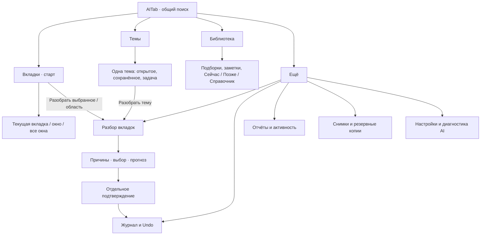
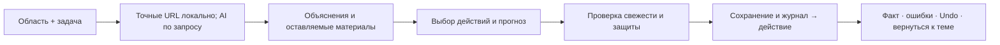

# План UX AITab: вкладки и темы как основа работы

Дата: 2026-10-19

Статус: **in-progress — реализация одобрена пользователем 2026-10-19.**

Основание: запрос и два скриншота пользователя; ревью исходников на `01dc077`.

## 1. Цель и рекомендуемое решение

Сделать AITab удобным ежедневным рабочим пространством: быстро найти открытую
страницу, понять её тему, продолжить работу, сохранить полезное и разобрать
повторы. Сокращение числа вкладок остаётся целью, но не должно заслонять работу
с материалами.

Предлагаемая основная навигация: **Вкладки · Темы · Библиотека · Ещё**.
«Вкладки» стоят первыми и открываются при новом запуске панели. Очистка получает
один экран **«Разбор вкладок»**, доступный через «Ещё» и контекстную кнопку
«Разобрать» во вкладках или теме. Отдельного верхнего раздела AI больше нет:
его функции размещаются рядом с задачей, которую они решают.

В интерфейсе используется одно понятие **«Тема»**. AI-кластер — источник
предложения темы, сохранённый кластер — существующие тематические данные.
Коллекция остаётся сохранённой подборкой, группа Chrome — способом расположить
открытые вкладки. Эти различия нужны для предсказуемых действий, но пользователю
не требуется разбираться в источниках хранения.

Этот документ продолжает [план развития продукта](product-development.md).
Действующие сценарии описаны в [README](../../README.md) и
[WORKSPACE.md](../WORKSPACE.md). Ниже — целевой дизайн и этапы будущей реализации,
а не описание уже доступных функций.

## 2. Что мешает сейчас

| Наблюдение | Последствие | Предлагаемое изменение |
|---|---|---|
| В шапке семь разделов, первым идёт Cleanup; внутри ещё девять разделов | Основная работа скрывается за очисткой, навигация занимает много места | Три рабочих раздела и «Ещё»; инструменты привязаны к контексту |
| Начальный `view` уже равен `tabs`, но порядок шапки другой | Визуальный приоритет расходится со стартовым экраном | Tabs первым; явные переходы к конкретной теме/отчёту сохраняются |
| Topics находится в Cleanup, кластеры — также в AI Analysis и Analytics | Одни материалы приходится искать и обслуживать в разных местах | Единый каталог тем и одна карточка темы |
| `TopicsPanel` последовательно добавляет коллекции, группы Chrome, AI и постоянные кластеры | Источники могут породить несколько похожих карточек; общего сопоставления нет | Стабильные темы, ссылки на источники, предложения объединения |
| В Topics есть ручная загрузка постоянных кластеров; App уже загружает их в другое состояние | Непонятно, полный ли список; два состояния одного источника | Общий репозиторий тем, автоматическая загрузка и видимый статус покрытия |
| У AI есть Start Cleanup Session, прямые Close, собственные темы и действия | Несколько путей разбора с различной подачей, отчётами и выбором | Один сценарий просмотра и применения плана для всех рекомендаций |
| На скриншоте общий статус Review complete / Preview expired показан над Topics | Завершённая сторонняя проверка выглядит как проблема текущего экрана | Краткий индикатор активных задач; результат привязан к своему контексту |
| Summary AI хранит текст старого анализа, счётчики ниже строятся по живым рекомендациям | Числа могут расходиться после изменения вкладок | Числа из единой актуальной модели; старое резюме помечено временем и областью |
| Поиск есть во вкладках, Library и отдельном Search по SQLite | Разные поля и непонятные границы поиска | Одна поисковая строка с явной областью; диалоговый поиск как дополнительный режим |
| `selectAll` выбирает все окна, а список может быть отфильтрован | «Выбрать всё» может затронуть невидимые вкладки | Выбор только результатов текущей области; скрытый выбор явно показан |
| В Topics галочка означает «оставить», в Duplicates — «закрыть», в Library — «сравнить пару» | Привычное действие меняет смысл между экранами | Галочка всегда выбирает строку; действие задаётся общей панелью |
| Быстрые действия TabItem появляются только при наведении; внутри темы отдельный скролл | Сложнее работать клавиатурой и в узкой панели | Постоянное меню действий, доступный фокус, отдельная страница темы |
| В Tabs `isStale` вычисляется по `lastAccessed`; подпись счётчика «неакт.» | Давность посещения воспринимается как ненужность содержания | Убрать этот показатель из очистки; актуальность требует содержательной причины |

На первом скриншоте «Claude Linkedin» объединяет 67 вкладок с неоднородными
заголовками. Это повод дать пользователю проверку состава и разделение темы.
По одному скриншоту нельзя заключить, что все эти страницы классифицированы
неверно. Большая тема сама по себе также не является ошибкой.

### Проверенные места в коде

- Навигация и старт: [Header.tsx](../../extension/src/side-panel/components/Header.tsx),
  [App.tsx](../../extension/src/side-panel/App.tsx), [store.ts](../../extension/src/side-panel/store.ts).
- Разделы очистки, общий прогресс и Undo: [WorkspaceView.tsx](../../extension/src/side-panel/components/WorkspaceView.tsx),
  [ReviewProgress.tsx](../../extension/src/side-panel/components/ReviewProgress.tsx).
- Источники тем: [TopicsPanel.tsx](../../extension/src/side-panel/components/TopicsPanel.tsx),
  [AIWorkspacePanel.tsx](../../extension/src/side-panel/components/AIWorkspacePanel.tsx),
  [AIRecommendations.tsx](../../extension/src/side-panel/components/AIRecommendations.tsx).
- Второй сценарий очистки: [CleanupSession.tsx](../../extension/src/side-panel/components/CleanupSession.tsx).
- Повседневная работа: [TabList.tsx](../../extension/src/side-panel/components/TabList.tsx),
  [TabItem.tsx](../../extension/src/side-panel/components/TabItem.tsx),
  [BulkActions.tsx](../../extension/src/side-panel/components/BulkActions.tsx).
- Поиск и история: [LibraryPanel.tsx](../../extension/src/side-panel/components/LibraryPanel.tsx),
  [ChatSearch.tsx](../../extension/src/side-panel/components/ChatSearch.tsx),
  [HistoryPanel.tsx](../../extension/src/side-panel/components/HistoryPanel.tsx).
- Давность посещения: [rules.ts](../../extension/src/shared/utils/rules.ts),
  [StatsBar.tsx](../../extension/src/side-panel/components/StatsBar.tsx),
  [translations.ts](../../extension/src/shared/i18n/translations.ts).

## 3. Новая карта интерфейса



В шапке — компактное название, навигация и поиск. Не дублировать крупный заголовок
AITab из оболочки браузера; в самой панели оставить одну компактную подпись.
Не делать две постоянно раскрытые полосы навигации. «Ещё» открывает короткое меню,
а не новую страницу со множеством равнозначных кнопок.

| Сейчас | Куда переносится |
|---|---|
| Tabs | Вкладки: основной список и работа с текущей страницей |
| Cleanup → Topics, AI → Clusters / Persistent clusters / Theme comparison | Темы: каталог, детали и предложения похожих тем |
| Cleanup → Collections и Library | Библиотека: переключатель «Материалы / Коллекции» |
| Cleanup → Optimize / Duplicates / Similar / Outdated, AI Cleanup Session | Один «Разбор вкладок»; категории становятся фильтрами результата |
| Cleanup → Windows | Вкладки → меню окна → «Объединить окна…» с прежним предпросмотром |
| Search | Общий поиск → «По смыслу / задать вопрос»; SQLite-источники включаются явно |
| AI → Analysis | Команды «Предложить темы», «Проверить повторы и актуальность»; общий статус задач |
| AI → Analytics | Ещё → Отчёты; состояние провайдера — в настройках |
| Cleanup → History | Ещё → Журнал операций, включая Undo |
| Верхний History | Ещё → Отчёты → Активность; это история посещений, отдельно от Undo |
| Snapshots | Ещё → Восстановление → Снимки |
| Полные бэкапы в Collections | Ещё → Восстановление → Резервные копии |
| Правила URL в Library | Библиотека → меню → Правила сохранения |

## 4. «Вкладки»: оперативная работа

### Первый экран

По умолчанию показывать все обычные окна, текущее — первым. Переключатель
«Текущее окно / Все окна» всегда виден, выбранная область сохраняется.
Внутри текущего окна сохранять порядок Chrome. Отдельный компактный блок текущей
страницы позволяет сразу сохранить её, отметить важной или перейти к её темам.

Поиск и выбранная тема не должны сбрасываться при переключении вкладки Chrome.
Автоматически прокручивать список к активной вкладке только по явной команде
«Показать текущую». Иначе панель будет мешать просмотру результатов.

Пример компоновки, числа условные:

```text
AITab                                             ⋯
Вкладки        Темы        Библиотека             Ещё
[ Найти вкладку, тему или сохранённый материал…     ]
Область: [Открытые ▾] [Все окна ▾]

Текущая: Документация React                  [В тему]
Есть в «Frontend»                        [Сохранить]

602 вкладки · 8 окон               [Разобрать…]
[По окнам ▾] [Все темы ▾] [Фильтры]
Окно 3 · текущее · 42
☐ Заголовок страницы                    frontend.dev ⋯
  Тема: Frontend · сохранено в «React»
☐ Другая страница                          github.com ⋯

Выбрано 12 · вне фильтра 0
[В тему] [Сохранить…] [Разобрать…] [⋯]
```

### Строка и действия

- Заголовок открывает/фокусирует страницу. Домен, окно и группа видны компактно;
  полный URL и детали раскрываются по запросу. Длинный заголовок — максимум две
  строки в обычном списке, полностью доступен в деталях.
- Статусы отвечают на вопросы: открыто/сохранено, тема, защита, есть точная копия,
  есть рекомендация к проверке. «Спящая» означает состояние Chrome, а не оценку
  полезности. Сходство URL не подписывать «повтор содержания».
- Постоянная кнопка «⋯» доступна мышью и клавиатурой. В меню: перейти, добавить
  в тему, сохранить, сохранить и закрыть, закрепить, отметить важной, экспорт,
  закрыть. Одинарное явное закрытие остаётся быстрым действием с Undo.
- Выбор строки универсален. После выбора появляется закреплённая панель:
  «В тему», «Сохранить», «Сохранить и закрыть», «Сравнить», «Закрыть».
  Редкие действия уходят в её меню. Углублённое сравнение доступно для двух страниц;
  причина ограничения видна рядом.
- «Выбрать результаты (N)» учитывает текущий запрос, окно и тему, включая
  ещё не отрисованные строки результатов. При смене фильтра показывать число
  скрытых выбранных строк и команды «Показать выбранные / Снять выбор».
- Защищённую страницу можно выбирать для сохранения или классификации.
  Доступность закрытия проверяется отдельно и объясняется текстом.

### Единый поиск

Одна строка и одна модель запроса: «Открытые / Сохранённые / Всё». При входе во
«Вкладки» начальная область — открытые, в «Библиотеку» — сохранённые; при явном
изменении области показывать его в строке фильтров. Темы ищутся по названию,
задаче, меткам и составу и имеют собственный тип результата.

Сохранить существующие `collection:`, `domain:`, `status:` и добавить видимые
фильтры темы и окна. Объединять точные обычные URL в результате материала,
но раскрывать все живые экземпляры для выбора и закрытия. Stateful-чаты
сохраняют отдельные экземпляры даже при одинаковом адресе.

Текстовый поиск даёт локальный результат сразу. AI-поиск запускается отдельной
командой и явно показывает область, доступность сервера и отправляемые данные.
Результаты истории/SQLite помечаются как исторические; они не превращаются
автоматически в сохранённую библиотеку. Открытие найденного материала сначала
ищет уже открытую подходящую копию.

## 5. «Темы»: единая модель вместо нескольких списков кластеров

### Понятия

| Сущность | Значение для пользователя | Связи |
|---|---|---|
| Тема | Задача или предмет: «Frontend», «Книга об AI», «Исследование рынка» | Связывает открытые экземпляры и сохранённые материалы; материал может относиться к нескольким темам |
| Коллекция | Сохранённая подборка ссылок с заметками и назначением | Может быть связана с темой; у темы может быть несколько коллекций |
| Группа Chrome | Визуальная группа живых вкладок в конкретном окне | Может представлять часть темы; группа не является архивом |
| Предложение AI | Неподтверждённое распределение или изменение состава | Превращается в тему/изменение после принятия; не перезаписывает ручные решения |

### Каталог и карточка темы

Поиск тем, сортировка по имени/числу открытых/последней работе с темой.
Фильтры: «В работе», «Все», «Предложения», «Без темы». У карточки — понятное имя,
короткая задача, число открытых вкладок и сохранённых материалов, отметка
«Есть похожая тема» или «Состав требует проверки». Источник AI/Chrome/коллекция
доступен в деталях и не занимает место в основном заголовке.

Сумма размеров тем может превышать общее число вкладок из-за пересечений.
Общий счётчик считает уникальные живые вкладки, а не сумму карточек.

Открытие темы ведёт на отдельный экран с возвратом в тот же участок каталога:

```text
← Темы / Frontend                             [⋯]
Задача: подготовить миграцию на текущую версию React
42 открыто · 26 сохранено · 3 окна
[Открытые] [Сохранённые] [Все материалы]
[Работать с темой] [Разобрать тему…]

Связана с «React notes» · похожа на «Web development»
[Сравнить темы]

Список материалов с общими выбором, поиском и действиями
```

«Работать с темой» фильтрует текущую рабочую область. Само включение режима
не открывает всю коллекцию и не перемещает окна. Группирование и сворачивание —
отдельная команда; предложение открыть сохранённое показывает только отсутствующие
страницы и требует выбора.

В меню темы: переименовать, изменить задачу, добавить/исключить материал,
разделить, сравнить/объединить с другой темой, сохранить подборку, сгруппировать
в Chrome, экспортировать, удалить тему. Удаление темы убирает организационные
связи; вкладки и коллекции сохраняются. Каждое изменение состава обратимо.

### Похожие и дублирующие темы

Нужно различать два независимых результата:

1. **Темы описывают одну задачу.** Можно объединить организацию материалов.
2. **Материалы повторяют содержание.** Можно предложить уменьшить число вкладок
   после отдельного сравнения и проверки уникальной информации.

Сначала искать кандидатов по общим материалам и вариантам названия. Далее при
явном запуске AI использовать задачу, состав и доступные фрагменты. Общее слово
«AI», один домен или высокая похожесть названий недостаточны для объединения.
Отдельно отличать связь «широкая тема → подтема» от одинаковой темы; в первой
версии достаточно связи «связанные темы», без обязательного дерева.

Экран сравнения пары показывает:

- общее и уникальное содержимое каждой темы;
- причины предложенного объединения и отличия задач;
- источники, качество доказательств и время проверки;
- выбранное итоговое имя и состав, сохранённые заметки и ссылки на коллекции;
- решения «Объединить темы», «Связать, оставить отдельно», «Разные темы».

Объединение тем не закрывает страницы и не удаляет исходные коллекции. Оно
сохраняет происхождение, пользовательские имена как прежние названия и обратимую
карту изменений. Повторный анализ не воссоздаёт уже объединённые темы отдельными
карточками. Решение «разные темы» учитывается до существенного изменения состава
или задачи. У широкой неоднородной темы можно предложить разделение с явным
остатком «не распределено», не теряя страницы.

### Как объединить существующие источники

Не ограничиваться переименованием подписей. Нужен `TopicCatalog` с постоянным
ID темы, ревизией, названием, задачей, ссылками на материалы и происхождением.
Предлагаемые новые модули и типы — часть будущей работы.

- Первый этап: общий адаптер поверх существующих данных. Один и тот же источник
  имеет стабильную ссылку: постоянный кластер по ID, коллекция по ID, AI-предложение
  по ID анализа и отпечатку состава. Группа Chrome привязывается к живой сессии;
  её числовой ID не считается постоянным после перезапуска.
- Локальный каталог хранит принятые темы, связи с источниками и пользовательские
  правки. Исходные кластеры SQLite и коллекции сохраняются; выводы нового анализа
  становятся предложениями изменения. Для старого серверного кластеризатора
  нужны правила сопоставления с каталогом, чтобы обновление не откатывало правки.
- Ссылка на материал отличает живой экземпляр, сохранённый элемент и URL-источник.
  Числовые tab ID не сохраняются как долговременная идентичность. Для обычных URL
  используется действующее точное сравнение; чаты не объединяются по адресу.
- Один материал может быть в нескольких темах. Действия применяются по уникальным
  живым ID с повторной проверкой URL. Имя темы не служит её идентификатором.
- Совпадение источника убирает техническую повторную карточку. Разные коллекции
  с одинаковым набором URL могут иметь разные задачи: объединять их автоматически
  нельзя. Смысловое объединение тем требует просмотра.
- Локальные темы доступны без сервера; сохранённая копия серверных данных имеет
  дату обновления. Загрузка недоступного источника не скрывает доступные темы.
- Миграция идемпотентна, с резервной копией и повторяемым восстановлением;
  каталог входит в JSON и полный бэкап. Старые форматы продолжают импортироваться.

## 6. AI и очистка: один сценарий с разными точками входа

### Где остаются функции AI

| Задача | Место и команда |
|---|---|
| Найти структуру среди текущих вкладок | Темы → «Предложить темы» с выбором области |
| Найти близкие темы / проверить широкую тему | Темы → «Проверить пересечения» / «Предложить разделение» |
| Сравнить содержание и актуальность | «Разобрать…» для окна, темы, выбора или всех вкладок |
| Уточнить спорную пару | Материалы → выбрать два → «Сравнить подробнее» |
| Найти материал по описанию | Общий поиск → «По смыслу / задать вопрос» |
| Посмотреть эффект и историю анализа | Ещё → Отчёты |
| Настроить модель и устранить ошибку соединения | Ещё → Настройки → AI |

Анализ по умолчанию относится к явно показанной области. Если действующий API
поддерживает только все вкладки, сначала расширить контракт и тесты; нельзя
подписать глобальный запуск как «проанализировать эту тему».

### Единый разбор

Вход в «Разобрать…» передаёт область и возвращает пользователя в исходную тему
или список. Есть один последовательный процесс:



Внутри результата фильтры, а не отдельные конкурирующие процессы:

- **Точные копии** — какая копия остаётся, какие экземпляры закрываются.
- **Пересечение содержания** — общее, уникальное, рекомендуемый рабочий набор.
  Дополняющие источники не выбраны для закрытия по умолчанию.
- **Возможно неактуально** — событие, версия, срок или несоответствие указанной
  задаче; конкретные доказательства, замена и возможность «Ещё нужно».
- **Можно сохранить и закрыть** — полезные материалы вне текущей работы,
  с выбранной коллекцией и понятным местом возвращения.
- **Нужна ручная проверка / недостаточно данных** — отдельная группа без обещания
  сокращения. В том числе чаты и источники с недоступным текстом.

У оставляемой копии — кнопка «Оставить эту» и явный статус. Универсальная галочка
выбирает строку, а подпись панели говорит, что произойдёт с выбором. Нельзя
показывать только неактивную галочку без причины.

В закреплённой панели: «Выбрано N; закрыть копии X; сохранить и закрыть Y;
останется Z» и конкретная кнопка применения. Операции разделены по смыслу:
«Сохранить» оставляет вкладки открытыми; «Сохранить и закрыть» записывает коллекцию
до закрытия; «Сгруппировать» не уменьшает число вкладок. Метка «Прочитать позже»
сама по себе не должна выглядеть как надёжно сохранённая ссылка.

Старые AI-рекомендации `close / archive / read_later / group / keep` становятся
входными предложениями этого процесса. Простая рекомендация `close` без доказательств
не становится подтверждённым дублем или автоматическим выбором. Старый пошаговый
Cleanup Session при необходимости сохраняется как режим «По одному» того же
плана, с общими данными, проверками, журналом и отчётом.

### Числа и отчёт

Общий счётчик работает по уникальным живым вкладкам. Если вкладка попала в несколько
тем/категорий, у неё может быть несколько оснований, но одно выбранное итоговое
действие. Конфликт «оставить / закрыть» требует решения; нельзя учитывать эту
вкладку как сохраняемую копию и одновременно закрывать.

Формула прогноза: `останется = открыто сейчас − уникальные выбранные закрытия`.
Сохранение без закрытия и группирование дают нулевое сокращение. Исторический
размер анализа, текущая область, число проверенных материалов и реальное
сокращение — разные показатели с явными подписями.

Отчёт: было/стало, успешно закрытые копии, сохранённые и закрытые, закрытые после
проверки актуальности, пропуски, ошибки. При параллельных действиях пользователя
показать отдельно изменение набора вне операции; не приписывать весь перепад AITab.
Числа в тексте, карточках и кнопке берутся из одной модели, а не из резюме LLM.

## 7. Прогресс, сохранение контекста и компактность

- Один общий центр задач для поиска, тематизации и содержательного разбора.
  В шапке только короткая строка активной задачи: название, область, этап,
  обработано/всего, отмена. Подробности раскрываются по клику.
- Для чтения фрагментов — измеримый прогресс. Для ожидания AI — этап и прошедшее
  время; процент/ETA только когда есть основание, иначе «Ожидаем ответ».
  Показывать кэш, пропуски и ограничения покрытия отдельно.
- Навигация и локальный поиск работают во время анализа. Смена экрана не запускает
  вторую такую же задачу. Отмена прекращает дальнейшую работу и сохраняет статус
  уже полученных результатов; возобновление доступно только при поддержке задачи.
- Разделить завершённый анализ, пригодный для просмотра, и временный план действий.
  Истёкший предпросмотр нельзя применить, но его объяснения остаются доступны.
  В его контексте показать «Предпросмотр истёк — обновить план». Если обнаружено
  изменение вкладок, указать его отдельно. Не держать Preview expired над
  несвязанной темой.
- Возвращаясь из темы/разбора, пользователь получает прежние запрос, область,
  прокрутку и допустимый выбор. Закрытые или изменившиеся элементы помечаются;
  старый выбор не применяется к новому URL.
- На основном экране один скролл содержимого; каталог и подробности темы разделены.
  Диалог подтверждения может иметь собственный ограниченный список. Нижняя панель
  не перекрывает последние строки и не занимает треть экрана без необходимости.
- Русские/английские подписи согласованы, цели нажатия удобны, есть видимый фокус,
  доступные названия, текстовые причины блокировки. Цвет не единственный носитель
  статуса. Проверить ширины 360/420/600 px и масштаб текста 200%.
- Для сотен вкладок — ограниченная отрисовка или виртуализация с сохранением выбора
  вне экрана, стабильными ключами и доступностью клавиатуры. Не рендерить сразу
  все раскрытые темы и не запускать серверную аналитику для простого входа в Tabs.

## 8. Этапы реализации и критерии приёмки

Выполненные пункты отмечены по результатам реализации и проверок. Каждый этап —
отдельный проверяемый пакет с документацией, подходящими тестами, коммитом и пушем.

### Этап 1. Навигация и корректный выбор — быстрый полезный результат

- [x] Перестроить Header/App: Вкладки, Темы, Библиотека, Ещё.
- [x] Вынести существующие Topics и Library из оболочки Cleanup, объединить точки
  входа в коллекции; сделать переходы с областью и возвратом.
- [x] Перенести историю операций, активность, снимки, настройки и окна по карте выше.
- [x] Исправить выбор отфильтрованных результатов и видимость скрытого выбора.
- [x] Убрать возрастной `stale` из оценки неактуальности; при сохранении метрики
  посещений показывать её только в активности с точной нейтральной подписью.
- [x] Добавить постоянное меню строки и компактную работу с текущей вкладкой.

Приёмка: при открытии видны вкладки и поиск; для поиска/сохранения не нужен Cleanup.
После фильтра по одному домену «Выбрать результаты» не выбирает остальные вкладки.
Все прежние функции достижимы, Undo не потерян при переносе экранов.

### Этап 2. Единые темы и совместимость данных

- [x] Ввести адаптер источников и общий каталог вместо независимых списков.
- [x] Добавить постоянную идентичность, пользовательское имя/задачу, происхождение,
  связи с коллекциями и локальное хранение принятой структуры.
- [x] Сделать экран темы с открытым/сохранённым составом и рабочим фильтром.
- [x] Добавить переименование, изменение состава и обратимость; перенести
  существующие операции кластеров в единое место.
- [x] Проверить миграцию, повторный анализ, офлайн-режим и перенос через бэкапы.

Приёмка: одна принятая тема показывается одной карточкой независимо от числа
источников; ручное название сохраняется после повторного анализа/перезапуска.
Удаление темы не удаляет коллекции и не закрывает страницы.

### Этап 3. Единый поиск и работа с библиотекой

- [ ] Объединить модель запроса и фильтры открытого/сохранённого/тем.
- [ ] Перенести смысловой/диалоговый поиск в дополнительный режим общей строки.
- [ ] Объединить карточки материала с переходом к живым копиям и коллекциям.
- [ ] Убрать настройки правил и полный AI-разбор из первого экрана результатов.
- [ ] Согласовать универсальный выбор, сравнение пары и открытие одного материала.

Приёмка: найти страницу по заголовку, заметке или теме и открыть/сфокусировать
одну копию можно без восстановления всей подборки. Локальный поиск работает без AI.

### Этап 4. Один разбор, один отчёт и прогресс

- [ ] Извлечь общий контроллер задач/плана из Workspace и адаптировать AI-рекомендации.
- [ ] Все входы передают явную область; категории результата используют один план.
- [ ] Подключить общий расчёт счётчиков, журнал, отчёт и возврат в исходный экран.
- [ ] Разделить срок действия анализа и предпросмотра; обновлять затронутый план.
- [ ] Перенести диагностику/аналитику из основного рабочего потока.
- [ ] Удалить дублирующие UI и исполнители только после проверки функционального
  соответствия. Существующие backend-проверки и журналирование сохраняются.

Приёмка: предложение из AI, темы или вкладок приводит в одинаковый сценарий
с одинаковым прогнозом для той же области. Смена раздела не теряет задачу.
На Topics не остаётся чужого сообщения об истёкшем предпросмотре.

### Этап 5. Пересечения, объединение и разделение тем

- [ ] Добавить кандидатов на основе общих материалов и названий; смысловую оценку
  применять по запросу и с объяснениями.
- [ ] Реализовать сравнение общего/уникального, объединение или связь тем,
  запоминание «разные темы», предложения разделения.
- [ ] Сохранять происхождение, заметки и ручную классификацию; поддержать Undo
  организационных изменений без запуска браузерных действий.
- [ ] Повторно проверять затронутые темы, сохраняя ранее принятые решения.

Приёмка: объединение двух тем не закрывает ни одной вкладки; у разных задач
с общими источниками можно оставить отдельные темы. Два разных видео об одной
профессии не становятся дублями только из-за близких заголовков.

### Этап 6. Проверка удобства, документация и внедрение

- [ ] Проверить основные сценарии на 600+ вкладках и пересекающихся темах.
- [ ] Проверить клавиатуру, ширины панели, увеличение текста, ошибки и офлайн.
- [ ] Переписать пользовательские маршруты и схемы в README/WORKSPACE; обновить
  ARCHITECTURE/PROJECT, CHANGELOG и отчёт о тестировании.
- [ ] Собрать расширение, проверить совместимый loader, прогнать CI; существующая
  установка обновляется через Reload с сохранением ID и данных.

Приёмка: пользователь выполняет основные задачи без знания слов «кластер»,
«SQLite» и внутренней структуры AI. Доступность настроек и восстановления сохранена.

## 9. Тесты и оценка результата

Это требования к будущей реализации, не результаты текущего запуска тестов.

| Уровень | Обязательные сценарии |
|---|---|
| Unit | Область/поиск/выбор, скрытый выбор, идентичность тем, пересечения, уникальные счётчики и конфликт действий |
| Unit / persistence | Идемпотентная миграция, несколько тем у материала, сохранение ручного имени, remap ID при импорте, восстановление каталога |
| Интеграция | Два источника одной темы, сервер недоступен, обновление AI после ручного merge/split, старый формат бэкапа |
| E2E | Вкладки первыми; текущая страница; поиск → сохранение → найти снова; тема → разбор → отчёт → Undo → возврат с фильтром |
| E2E | Фильтр одного окна/домена → выбрать результаты; невидимые страницы не закрываются; protected/chat пояснения доступны |
| E2E | Пара тем с общими и уникальными материалами → merge → Undo; число живых вкладок не меняется |
| E2E | Анализ → смена экрана → отмена/возврат; истёкший план → обновление; закрытая вкладка не заменяется новым ID без проверки |
| Регрессия | Разные разговоры ChatGPT и корневые URL с черновиками, разные авторы, старый полезный справочник, ошибка сохранения до закрытия, частичное выполнение |
| UI / нагрузка | 600–1 000 вкладок, десятки тем, длинные RU/EN заголовки, 360/420/600 px, 200% текст, клавиатура и отсутствие горизонтального скролла |

Замерить до/после на одном синтетическом наборе: время нахождения нужной вкладки,
число переходов до сохранения и до разбора темы, время возврата к сохранённому,
число ошибочных массовых выборов и успешность Undo. Дополнительно — задержку
локального поиска и время первого полезного отображения без ожидания сервера.
Цель для локального поиска: p95 до 200 мс на фиксированном тестовом устройстве
после загрузки индекса; это целевой бюджет, а не выполненное измерение.

Продуктовые критерии: меньше действий для повседневных задач, понятный прогноз
сокращения, сохранение уникальных источников. Само уменьшение числа вкладок или
карточек тем не доказывает удобство. Для проверки не нужна новая телеметрия:
достаточно локальных замеров и сценариев на изолированных данных.

## 10. Компромиссы и порядок

- Простая перестановка кнопок быстро улучшит первый экран, но оставит две очистки
  и несколько независимых тем. Поэтому первый этап полезен сам по себе, а единый
  каталог и общий разбор — обязательное продолжение.
- Полностью скрывать очистку слишком глубоко неудобно. «Ещё → Разбор вкладок»
  даёт глобальный вход, контекстная кнопка «Разобрать» — быстрый путь из работы.
- Немедленно сливать коллекции и кластеры в одну таблицу рискованно для заметок,
  статусов и совместимости. Сначала общий каталог со ссылками и проверяемой
  миграцией; физическое объединение хранилищ для UX не требуется.
- Автоматическое объединение по названию/теме создаёт ложные совпадения. В первой
  версии объединение смысловых тем подтверждается; точное сопоставление одного
  источника лишь устраняет повторное отображение.
- Полноценное дерево тем, полноэкранный режим, перетаскивание, внешняя проверка
  актуальности и автоматическое закрытие по расписанию не входят в этот пакет.
  Сначала стабилизировать поиск, тему, выбор, разбор и восстановление.

Рекомендуемый порядок: **быстрая навигация и выбор → единые темы → общий поиск →
единый разбор → пересечения тем → проверка и внедрение**. Реализация выполняется поэтапно с проверками и сохранением совместимости.

## Журнал реализации

2026-10-19, этап 1: новая навигация, прямой доступ к темам/библиотеке, меню восстановления и журнала; выбор результатов с учётом окна/поиска/темы, счётчик скрытого выбора, постоянное меню строк, работа с текущей страницей, ограниченная отрисовка. Убран возрастной индикатор из Tabs. Проверки: strict TypeScript и production build; 153 Vitest, 12 Chromium E2E, включая реальный FastAPI и SQLite. Последующие этапы выполняются далее.

2026-10-19, этап 2: Постоянный каталог тем, адаптеры четырёх источников, карточка темы, ручные названия/задачи/состав, локальные данные и серверный кэш, обратимые изменения и перенос в JSON/полных бэкапах. 163 Vitest; strict TypeScript и production build. Пять целевых Chromium E2E прошли: сохранение, перезапуск, рабочий минимум и Undo. Проверка учитывает перестановку полей Chrome storage; пользовательские правки имеют отдельную ревизию.
